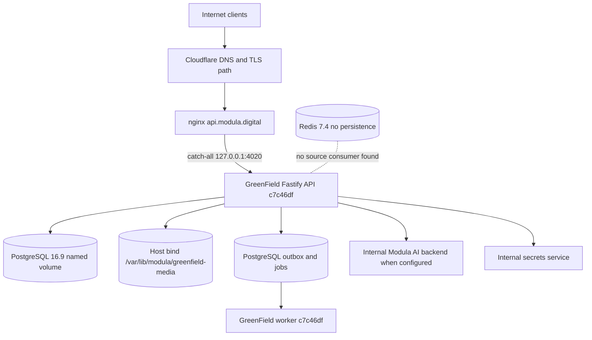

Observed production truth at 2026-10-04T08:18:44.111Z: api.modula.digital terminates at nginx and proxies to a healthy loopback-only Fastify container running `b45b5be4844befd451b827bbc30f4d48f0ac34d1`, backed by PostgreSQL 16.9, a same-revision worker, host-bound media storage, and an apparently unused Redis service.

# Production Truth

## Host and repository

- Host: `core.modula.digital`; OS: Ubuntu 24.04.4 LTS; architecture: x86_64; kernel: Linux 6.8.0-137-generic; uptime: up 8 weeks, 9 hours, 36 minutes.
- Canonical checkout: `/root/modula-latest`; origin: `https://github.com/modula-mod/modula-latest.git`; branch: `main`; HEAD: `38f33bdc3ce7de6b0c96674a7d293f2169dc4865`.
- Canonical checkout is dirty: 0 tracked modifications and 0 untracked files. Those files were not changed by this audit.
- `origin/main` at capture: `38f33bdc3ce7de6b0c96674a7d293f2169dc4865`.
- Running SHA: `b45b5be4844befd451b827bbc30f4d48f0ac34d1`. It is not canonical checkout HEAD and not `origin/main`. OCI revision, `/version.json`, worker heartbeat and runtime route introspection correlate the running code to this exact source revision.
- Audit worktree: `/root/modula-worktrees/api-baseline-02-settings-v2-capture`, branch ``.

## Runtime inventory

| Role | Container/image | Created | Ports | Health | Revision |
| --- | --- | --- | --- | --- | --- |
| API | `modula-greenfield-api:b45b5be4844befd451b827bbc30f4d48f0ac34d1` | 2026-10-03T19:49:34.656562481Z | `127.0.0.1:4020 -> 4020` | healthy | `b45b5be4844befd451b827bbc30f4d48f0ac34d1` |
| Worker | `modula-greenfield-worker:b45b5be4844befd451b827bbc30f4d48f0ac34d1` | 2026-10-03T19:49:34.860241026Z | internal only | no Docker healthcheck | `b45b5be4844befd451b827bbc30f4d48f0ac34d1` |
| Database | `postgres:16.9-alpine` | 2026-09-20T19:23:12.840616636Z | Docker network only | healthy | image-pinned PostgreSQL |
| Redis | `redis:7.4-alpine` | 2026-08-09T00:27:09.295758521Z | Docker network only | healthy | no GreenField source consumer found |

- Host Node v24.15.0; container Node v24.18.0; pnpm 11.11.0; npm 11.12.1; nginx/1.31.3.
- PostgreSQL data uses a named Docker volume. Media uses read/write host bind `/var/lib/modula/greenfield-media`; 46 files / 26307802 bytes were counted without reading user contents.
- PostgreSQL queue/outbox drives asynchronous work. Redis reports append-only disabled and snapshot saving disabled; no GreenField source reference was found.
- Related internal services on the Docker network: Modula AI backend and secrets service. Their own repositories are outside this atlas. Old verifier/recovery/preview PostgreSQL containers are explicitly non-production and listed in sanitized evidence.

## Edge topology

`api.modula.digital` resolves through Cloudflare. The observed certificate is issued by Google Trust Services for `modula.digital` and expires 2026-11-11.

## nginx public routing

- Config: `/etc/nginx/conf.d/api.modula.digital.greenfield.conf`; SHA-256 `8fbed6189f4bb1113ea61467ebb4adc3c777a92c93d2d30597393e1acebf0535`.
- Default catch-all: 1 MiB request body, 10s connect, 60s send/read, no-store, HTTP/1.1 proxy to loopback API.
- Registry release assets: separate immutable-cache location.
- `/v1/stories`: 25 MiB and 300s timeouts.
- attachment byte upload: 101 MiB, proxy buffering disabled, 300s timeouts.
- Security headers: nosniff, DENY framing, no-referrer. No nginx request-rate directive or WebSocket upgrade stanza was found; 390/393 application routes carry Fastify rate-limit configuration.
- Every registered route is transport-reachable through the catch-all; feature flags and handler authorization still determine application availability. `/v1/internal/ssrf-check` is handler-hidden in production.

## Versions and migration truth

- Applied migrations: 63; latest `063_settings_backend_v2` at 2026-10-03T19:30:21.887429+00:00.
- Git up migrations: 63; latest `063_settings_backend_v2.sql`. No missing, extra, duplicate-numbered or out-of-order production migration was found.
- Runtime routes: 551; application routes: 393; excluded automatic framework routes: 158.

## Safe configuration

| Setting | Observed value |
| --- | --- |
| `NODE_ENV` | `production` |
| `MODULA_ENVIRONMENT` | `production` |
| `MODULA_API_HOST` | `0.0.0.0` |
| `MODULA_API_PORT` | `4020` |
| `MODULA_PUBLIC_API_URL` | `https://api.modula.digital` |
| `MODULA_PUBLIC_WEB_URL` | `https://modula.digital` |
| `MODULA_MEDIA_ROOT` | `/var/lib/modula/greenfield-media` |
| `MODULA_MEDIA_UPLOAD_MAX_BYTES` | `20971520` |
| `MODULA_REQUEST_BODY_LIMIT_BYTES` | `26214400` |
| `MODULA_RATE_LIMIT_ENABLED` | `true` |
| `MODULA_TRUST_PROXY` | `true` |
| `MODULA_PRODUCTION_WRITES_ENABLED` | `true` |
| `MODULA_PREVIEW_WRITES_ENABLED` | `false` |
| `MODULA_INVITE_ONLY` | `false` |
| `MODULA_REGISTRATION_MODE` | `open` |
| `MODULA_MINIMUM_CLIENT_VERSION` | `0.1.0` |
| `MODULA_API_DOCUMENTATION_ENABLED` | `false` |
| `MODULA_ATPROTO_ENABLED` | `false` |
| `MODULA_PDS_PILOT_ENABLED` | `false` |
| `GREENFIELD_MODULE_REGISTRY_ENABLED` | `true` |
| `GREENFIELD_MODULE_INSTALLATION_ENABLED` | `true` |
| `GREENFIELD_MODULE_DECLARATIVE_CONTRIBUTIONS_ENABLED` | `true` |
| `GREENFIELD_MODULE_FIRST_PARTY_EXECUTION_ENABLED` | `true` |
| `GREENFIELD_MODULE_REMOTE_FUNCTIONS_ENABLED` | `false` |
| `GREENFIELD_MODULE_COMMUNITY_EXECUTION_ENABLED` | `false` |
| `GREENFIELD_MODULE_GITHUB_SYNC_ENABLED` | `false` |
| `GREENFIELD_VAULT_NOTES_REFERENCE_ENABLED` | `true` |
| `GREENFIELD_DIMON_ENABLED` | `false` |
| `GREENFIELD_AI_GATEWAY_ENABLED` | `true` |
| `BACKEND_FABRIC_ENABLED` | `false` |
| `BACKEND_FABRIC_ENVIRONMENT` | `production` |
| `BACKEND_FABRIC_CONTRACT_VERSION` | `1.0` |
| `MODULA_RELEASE_SHA` | `b45b5be4844befd451b827bbc30f4d48f0ac34d1` |
| `MODULA_WORKER_RELEASE_SHA` | `b45b5be4844befd451b827bbc30f4d48f0ac34d1` |
| `MODULA_RELEASE_BUILT_AT` | `2026-10-03T19:48:10Z` |
| `worker:NODE_ENV` | `production` |
| `worker:MODULA_ENVIRONMENT` | `production` |
| `worker:MODULA_MAIL_TRANSPORT` | `smtp` |
| `worker:MODULA_MAIL_REQUIRED` | `true` |
| `worker:MODULA_SMTP_PORT` | `587` |
| `worker:MODULA_SMTP_SECURE` | `false` |
| `worker:MODULA_SMTP_REQUIRE_TLS` | `true` |
| `worker:MODULA_SMTP_TLS_REJECT_UNAUTHORIZED` | `true` |
| `worker:MODULA_WORKER_INGEST_ENABLED` | `false` |
| `worker:MODULA_WORKER_INGEST_INTERVAL_MS` | `60000` |
| `worker:MODULA_WORKER_POLL_INTERVAL_MS` | `1000` |
| `worker:MODULA_WORKER_EMPTY_POLL_BACKOFF_MS` | `5000` |
| `worker:MODULA_WORKER_OUTBOX_BATCH_SIZE` | `50` |
| `worker:MODULA_WORKER_OUTBOX_DRAIN_INTERVAL_MS` | `2000` |
| `worker:MODULA_WORKER_LEASE_DURATION_MS` | `60000` |
| `worker:MODULA_WORKER_LEASE_REAP_INTERVAL_MS` | `30000` |
| `worker:GREENFIELD_MODULE_GITHUB_SYNC_ENABLED` | `false` |
| `worker:GREENFIELD_MODULE_REMOTE_FUNCTIONS_ENABLED` | `false` |
| `worker:GREENFIELD_MODULE_COMMUNITY_EXECUTION_ENABLED` | `false` |
| `worker:MODULA_RELEASE_SHA` | `b45b5be4844befd451b827bbc30f4d48f0ac34d1` |

## Secret-presence inventory

Only presence status was captured; no value is present in this atlas.

| Secret setting | Status |
| --- | --- |
| `MODULA_DATABASE_URL` | PRESENT |
| `MODULA_DATABASE_MIGRATOR_URL` | PRESENT |
| `MODULA_BACKUP_DATABASE_URL` | PRESENT |
| `MODULA_SESSION_PEPPER` | PRESENT |
| `MODULA_AI_PROVIDER_CREDENTIAL_ENCRYPTION_KEY` | PRESENT |
| `MODULA_ATPROTO_OAUTH_ENCRYPTION_KEY` | PRESENT |
| `MODULA_CONNECTOR_CREDENTIAL_ENCRYPTION_KEY` | PRESENT |
| `BACKEND_FABRIC_SIGNING_PRIVATE_KEY` | PRESENT |
| `MODULA_CHECKPOINT_SIGNING_KEY` | PRESENT |
| `worker:MODULA_DATABASE_URL` | PRESENT |
| `worker:MODULA_SMTP_PASSWORD` | PRESENT |
| `worker:MODULA_SMTP_USER` | PRESENT |
| `worker:MODULA_ATPROTO_OAUTH_ENCRYPTION_KEY` | PRESENT |
| `worker:BACKEND_FABRIC_SIGNING_PRIVATE_KEY` | PRESENT |

## External service dependencies

| Dependency | Status | Evidence |
| --- | --- | --- |
| SMTP email | CONFIGURED | smtp transport required, TLS required, username/password PRESENT; mail.deliver jobs have succeeded |
| Mail identity provisioner | UNCONFIGURED | provisioning disabled; historical jobs failed/dead-lettered with MAIL_PROVISIONER_DISABLED |
| AI/model providers | PLACEHOLDER | real provider rows are unconfigured; development mock is available but excluded in production resolution |
| Internal Modula AI backend | CONFIGURED NETWORK DEPENDENCY | container and URL key exist, but no operational model/provider execution was observed |
| GitHub registry source | UNCONFIGURED | sync code exists; automation false and source count zero |
| Filesystem media | CONFIGURED | host bind; no external object storage/CDN origin |
| AT Protocol/PDS | NOT USED | both feature flags false; placeholder preview code remains feature-gated |
| Connector OAuth | PARTIAL | credential encryption key PRESENT and provider metadata/routes exist; no provider webhook ingress |
| Push/APNs/web push | NOT USED | no subscription or delivery infrastructure found |
| Payment provider | NOT USED | DIMON disabled and no payment-service integration found |
