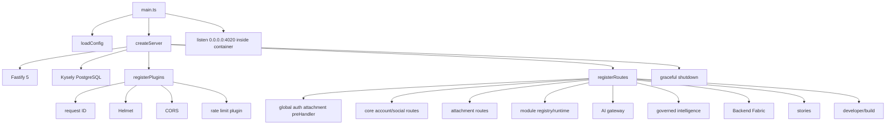

# Application Boot Map

## Process graph

`services/greenfield-api/src/main.ts:1-8`

`loadConfig() -> createServer() -> app.listen({host, port})`

`services/greenfield-api/src/app/create-server.ts:14-47`

`Fastify -> createDb -> registerPlugins -> registerRoutes -> graceful shutdown`

`services/greenfield-api/src/app/register-plugins.ts:8-41`

1. request-id onRequest hook;
2. global Helmet headers;
3. origin allow-list CORS;
4. non-global Fastify rate limiter when enabled.

`services/greenfield-api/src/app/register-routes.ts:148-214`

1. instantiate domain services;
2. global preHandler attaches legacy and Greenfield bearer authentication;
3. register health/version/meta and primary route families;
4. register module, AI, Backend Fabric, intelligence, social, stories, developer, entitlement, account-data, attachment and provider route groups;
5. handlers perform authorization and validation; no global schema-validation layer or global custom error handler is registered.

## Actual production boot

- Image: `modula-greenfield-api:736056445f5e09f968488a3ec66dddfaffea6f08`
- Image ID: `sha256:80acf6fc51678fa0b53fe60a0d36a6496cb3da9e48d888bf5393ac75e4fc9071`
- Revision: `736056445f5e09f968488a3ec66dddfaffea6f08`
- Command: `docker-entrypoint.sh node services/greenfield-api/dist/main.js`
- Working directory: `/app`
- Host binding: loopback `127.0.0.1:4020 -> container 4020`
- Fastify application routes: 408
- Automatic HEAD routes: 165
- Framework OPTIONS routes: 1

## Registration graph

