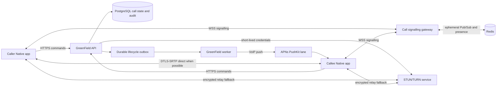
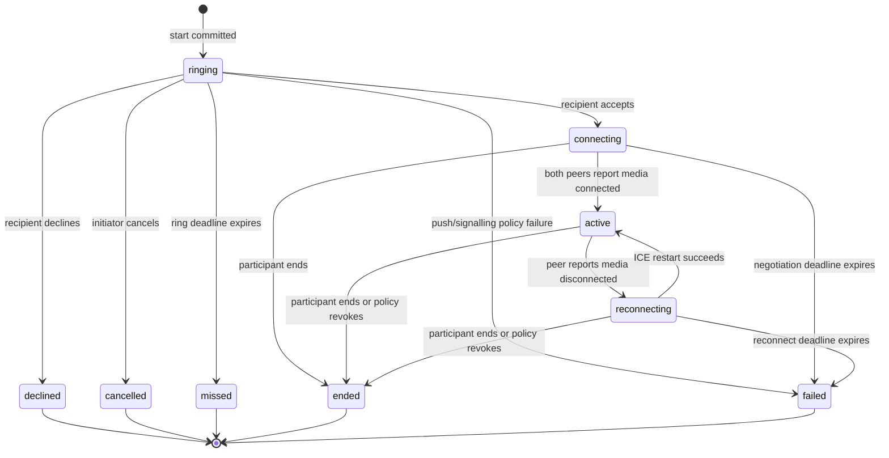

# Modula calls architecture

Status: DESIGN ONLY — NOT IMPLEMENTED OR DEPLOYED

Mission: GREENFIELD-FEATURE-REALITY-01 / PR-08

Date: 2 November 2026

Repository baseline: `modula-mod/modula-latest` at `f4f70bfa761556ce9460cbd7ade2c2dfabf9c38c`

Native reference: `modula-mod/modula-native` remote main at `e50fc3916fb4738b7c63b7bed92bef49a8076eb8`

Owner approval required: Andy must approve implementation, infrastructure procurement, deployment, retention policy and Native enablement.

## Capability statement

This document proposes a secure 1:1 voice/video calling architecture. It does not add routes, schemas, migrations, sockets, workers, PushKit support, TURN credentials, call UI or media infrastructure. Every path and event in this document is reserved design vocabulary and must not be added to the implemented API Atlas until working runtime code is separately approved, tested and deployed.

The initial product is:

- authenticated 1:1 audio calls;
- authenticated 1:1 video calls;
- one active call per actor by default;
- calls bound to an accepted direct-message conversation;
- WebRTC peer-to-peer media where possible, with mandatory TURN fallback;
- persistent server-authoritative lifecycle and history;
- ephemeral offer/answer and ICE signalling;
- PushKit and CallKit integration on iOS;
- no recording, transcription, PSTN, emergency calling, payments or group calling.

The design preserves an upgrade path to an SFU for group calls without changing call IDs, lifecycle commands or history contracts.

## Observed repository baseline

The design reuses these existing GreenField boundaries:

- `greenfield_conversations`, `greenfield_conversation_members` and `MessagingService` already provide deterministic 1:1 identity, membership, message-request state and block enforcement.
- `blocks` is checked in both directions before direct-message creation and sending.
- authenticated access tokens are opaque, hashed at rest, expire after the configured short access-token lifetime and are resolved server-side.
- Fastify already uses `@fastify/websocket` for the GUBIC lobby socket.
- PostgreSQL is the authoritative data store and already supports append-only domain events and transactional outbox-style delivery.
- Redis 7.4 is present in the production composition, but the API does not currently use it as a shared realtime bus.
- the push worker already provides APNs HTTP/2 delivery, invalid-token pruning, retry classification and device binding for ordinary alert notifications.
- ordinary push currently uses alert tokens, quiet-hours policy, a durable retry queue and a default one-day expiry. Those semantics are not safe for incoming calls.
- the observed production topology is one API process, one worker, one Redis instance and one PostgreSQL instance on one VPS. That topology is not sufficiently redundant for production calling.
- nginx currently clears connection-upgrade headers on the catch-all location. A dedicated, reviewed WebSocket location would be required.
- current Native main has no CallKit, PushKit, WebRTC, call repository or call UI implementation. It has ordinary APNs support and polls direct messages.

The existing GUBIC in-memory lobby hub is a useful WebSocket framing reference, but it is not suitable as the call bus because it cannot survive process restarts or support multiple API replicas.

## Architectural decisions

| Concern | Decision |
|---|---|
| Product ownership | Calls are a core messaging capability bound to an accepted direct conversation, not a downloadable module or parallel chat system. |
| Authority | PostgreSQL owns call identity, participants, lifecycle revision, terminal result, history and audit evidence. |
| Realtime | A dedicated authenticated WebSocket carries signalling and lifecycle notifications. HTTP remains the command/recovery boundary. |
| Shared bus | Redis Pub/Sub carries ephemeral SDP/ICE relay between API replicas; durable lifecycle changes use PostgreSQL plus the existing domain-event/outbox pattern. |
| Media | WebRTC transports audio/video directly between peers where possible. GreenField API and Redis never proxy media. |
| NAT traversal | STUN is required and TURN fallback is mandatory. TURN credentials are short-lived and issued only to authorized call participants. |
| Incoming iOS calls | A separate PushKit VoIP token is used. The existing ordinary APNs token and retry queue are not reused as if they had call semantics. |
| Native system UI | iOS uses CallKit for incoming/outgoing call lifecycle and system audio-session coordination. |
| Encryption claim | Media uses WebRTC DTLS-SRTP. Modula must not market this design as independently verified end-to-end encryption because the signalling service remains trusted. |
| Recording | No server or client recording, transcription or content retention in phase 1. |
| Failure policy | State and history fail closed; active peer media may continue briefly during signalling loss, but no new call or new TURN credential is issued while authorization cannot be proven. |
| Group-call future | Stable call/session contracts sit in front of a replaceable `MediaTopologyProvider`; a future SFU does not change public lifecycle routes. |

## Component topology



PostgreSQL remains sufficient to reconstruct the authoritative call. Redis loss may require a fresh offer/answer exchange, but it must not corrupt lifecycle or history.

## Domain model

The exact migration is deferred. The implementation should extend the existing migration system with these conceptual records.

### `greenfield_calls`

| Field | Purpose |
|---|---|
| `call_id` | UUIDv7-compatible opaque ID; also the stable CallKit UUID. |
| `conversation_id` | Existing direct conversation. Recipient is derived from active membership, never request JSON. |
| `initiator_actor_id` | Authenticated caller. |
| `media_kind` | `audio` or `video`. |
| `state` | `ringing`, `connecting`, `active`, `reconnecting`, `declined`, `cancelled`, `missed`, `ended` or `failed`. |
| `revision` | Monotonic optimistic-concurrency revision. |
| `ring_deadline_at` | Server deadline, recommended 30 seconds after commit. |
| `accepted_at` | First valid recipient acceptance. |
| `connected_at` | Time both participant devices reported media connected. |
| `ended_at` | Terminal transition time. |
| `terminal_reason` | Bounded machine-readable reason, never arbitrary client text. |
| `ended_by_actor_id` | Nullable authenticated actor responsible for a terminal command. |
| `idempotency_key` | Caller-scoped create key. |
| `created_at`, `updated_at` | Server timestamps. |

Required invariants:

- unique `(initiator_actor_id, idempotency_key)`;
- at most one non-terminal call per conversation;
- initially at most one accepted/connecting/active call per actor, enforced under ordered actor advisory locks;
- `connected_at >= accepted_at >= created_at` when populated;
- terminal states require `ended_at` and cannot transition again;
- state mutation and append-only transition event commit in one transaction.

### `greenfield_call_participants`

Exactly two rows initially, both derived from the direct conversation:

- `call_id`, `actor_id`, `role` (`initiator` or `recipient`);
- response state (`invited`, `accepted`, `declined`);
- selected device ID after the first accepted device wins;
- last signalling presence and last reported media state;
- joined, left and updated timestamps.

No client can add or redirect a participant.

### `greenfield_call_device_invitations`

One row per eligible recipient device:

- binds call, actor and server-owned device installation;
- tracks VoIP push enqueue, APNs result, ringing acknowledgement and `answered_elsewhere` cancellation;
- never stores a raw token in audit metadata;
- lets one device accept while all other devices dismiss the same CallKit UUID.

### `greenfield_call_events`

Append-only lifecycle audit:

- event ID, call ID, revision and event type;
- prior and resulting state;
- authenticated actor, session and device references;
- request/correlation/idempotency IDs;
- bounded reason code and safe metadata;
- occurred and recorded timestamps.

Unique `(call_id, revision)` and caller-scoped idempotency constraints prevent duplicate lifecycle side effects. SDP, ICE candidates, IP addresses, TURN passwords and raw access tokens are prohibited.

### `greenfield_call_signalling_tickets`

- single-use random ticket returned once;
- only a peppered hash is persisted;
- bound to call, actor, GreenField session and device;
- 60-second issuance lifetime;
- consumed, revoked and expiry timestamps;
- all unconsumed tickets revoked on terminal transition, block, session revocation or device removal.

### `greenfield_call_push_tokens`

PushKit VoIP tokens are separate from ordinary `push_device_tokens` because their APNs topic, entitlement and delivery semantics differ. Store an encrypted token plus a deterministic lookup hash, account/actor/device binding, environment, bundle/topic, last-seen and disable metadata. Each registration references an existing owned `push_device_tokens.id`, so call commands and push delivery share one server-issued installation identity. Reassignment on sign-in must follow the ordinary device-token ownership rule and disable the prior actor's VoIP registration atomically.

## State machine

The canonical diagram is in [`calls-state-machine.mmd`](./calls-state-machine.mmd).



### Transition rules

1. `start` locks both actor IDs in lexical order, rechecks active conversation membership, blocks, account status, privacy settings, rate limits and busy state, then creates `ringing` plus the durable push/outbox work atomically.
2. the recommended ring deadline is 30 seconds. A worker claims expired rows using `FOR UPDATE SKIP LOCKED` and transitions them to `missed` exactly once.
3. the first recipient device to accept wins. Other recipient devices receive `call.answered_elsewhere`; a second accept is an idempotent replay or `CALL_ALREADY_ANSWERED`.
4. an explicit user decline from any recipient device terminates ringing. A device that cannot ring must report `device.unavailable`, not impersonate user decline.
5. only the initiator may cancel, and only while ringing.
6. accept moves to `connecting`. A recommended 20-second negotiation deadline ends as `failed/negotiation_timeout` if media never connects.
7. `active` begins only after both selected devices report WebRTC media connected for the same negotiation ID.
8. a transient ICE loss enters `reconnecting`; clients perform one coordinated ICE restart. The recommended reconnect grace is 30 seconds.
9. either actor can end a connecting, active or reconnecting call. Blocks, account suspension or authorization loss also end it with a policy reason.
10. terminal results are immutable. Later duplicate commands return the existing snapshot with `replay: true` when the idempotency key matches, otherwise `409 CALL_ALREADY_TERMINAL`.

Signalling-socket loss alone does not prove media loss and must not immediately end a direct WebRTC call. The client continues media, reconnects signalling and reconciles the server snapshot. A client-reported media failure or reconnect deadline drives state.

## Proposed HTTP contracts

These routes are design-only and absent from the implemented Atlas. The machine-readable proposal is [`CALLS-PROPOSED-CONTRACTS.json`](./CALLS-PROPOSED-CONTRACTS.json).

All JSON responses use the existing GreenField `{ok,data,meta}` or `{ok:false,error,meta}` envelope. Private routes require the normal opaque access token and `calls:use` capability. Mutation bodies reject unknown fields. Call IDs that are nonexistent or unauthorized return the same `404 NOT_FOUND` envelope.

| Method | Proposed path | Purpose |
|---|---|---|
| POST | `/v1/conversations/:conversationId/calls` | Start an audio/video call for the authenticated member. |
| GET | `/v1/calls/:callId` | Recover the authorized call snapshot. |
| GET | `/v1/me/calls` | Cursor-paginated call history. |
| POST | `/v1/calls/:callId/accept` | Recipient accepts from one owned device. |
| POST | `/v1/calls/:callId/decline` | Recipient explicitly declines. |
| POST | `/v1/calls/:callId/cancel` | Initiator cancels before acceptance. |
| POST | `/v1/calls/:callId/end` | Either participant ends connecting/active/reconnecting. |
| POST | `/v1/calls/:callId/signalling-ticket` | Issue a one-time WebSocket ticket for an authorized owned device. |
| POST | `/v1/calls/:callId/media-credentials` | Issue short-lived STUN/TURN configuration. |
| POST | `/v1/push/voip-devices` | Register or refresh a PushKit token against an owned device installation. |
| GET | `/v1/push/voip-devices` | List safe VoIP registration metadata for the authenticated actor. |
| DELETE | `/v1/push/voip-devices/:registrationId` | Disable one owned VoIP registration without exposing its token. |
| GET | `/v1/me/call-settings` | Read server-backed call privacy and device policy. |
| PATCH | `/v1/me/call-settings` | Update policy with optimistic concurrency. |

### Start

`POST /v1/conversations/:conversationId/calls`

Headers:

- `Authorization: Bearer <access>`;
- `Idempotency-Key: <16..128 printable characters>` required.

Body:

```json
{
  "mediaKind": "audio",
  "deviceId": "server-issued-device-id"
}
```

The server derives initiator and recipient. `201` returns:

```json
{
  "ok": true,
  "data": {
    "call": {
      "id": "019a...",
      "conversationId": "...",
      "mediaKind": "audio",
      "state": "ringing",
      "revision": 1,
      "initiatorActorId": "...",
      "recipientActorId": "...",
      "ringDeadlineAt": "2026-11-02T12:00:30.000Z",
      "acceptedAt": null,
      "connectedAt": null,
      "endedAt": null,
      "terminalReason": null
    }
  },
  "meta": {"requestId": "..."}
}
```

The request creates no call if push/signalling prerequisites are disabled, the conversation is pending, either direction is blocked, recipient policy denies calls, either actor is busy or infrastructure isolation is not healthy.

### Lifecycle commands

Accept, decline, cancel and end require `Idempotency-Key` and:

```json
{
  "deviceId": "server-issued-device-id",
  "expectedRevision": 1,
  "reason": "user_action"
}
```

`reason` is an endpoint-specific enum. It is never free text. Accept returns the updated `connecting` snapshot. The client then requests signalling and media credentials. Decline/cancel/end return the terminal snapshot.

### Snapshot and history

`GET /v1/calls/:callId` returns the latest authorized snapshot and server time. The client must call it after cold launch, delayed push, socket reconnect or revision conflict.

`GET /v1/me/calls?cursor=<opaque>&limit=30&conversationId=<optional>` returns stable descending `(created_at, call_id)` pagination, bounded at 50. History includes the other participant's safe current profile summary, media kind, direction, terminal result, start/end times and duration. It never includes SDP, ICE, TURN details or private device data.

### Signalling ticket

`POST /v1/calls/:callId/signalling-ticket`

Body:

```json
{"deviceId":"server-issued-device-id"}
```

Returns a 256-bit random single-use ticket, `wss://api.modula.digital/v1/calls/:callId/signalling`, protocol version and expiry. The ticket is sent in the WebSocket `Authorization` header, never a query string. Issuing a new ticket revokes prior unconsumed tickets for the same call/actor/device. The raw value is never logged or returned again.

### Media credentials

`POST /v1/calls/:callId/media-credentials`

Returns `iceServers`, `expiresAt`, `iceTransportPolicy` and `credentialVersion`. Credentials are call/actor/device authorized, short-lived (recommended 10 minutes), rate-limited and refreshable before expiry. Provider root secrets never reach clients.

TURN REST credentials should embed expiration, call, actor and device pseudonymous IDs in the username and use a rotated server-side shared secret. Managed-provider credentials follow the provider's ephemeral token API.

### Call settings

Recommended initial schema:

```json
{
  "incomingCalls": "accepted_directs",
  "allowVideo": true,
  "ringOnDevices": "all",
  "relayOnly": false,
  "version": 3,
  "updatedAt": "2026-11-02T12:00:00.000Z"
}
```

`incomingCalls` initially supports `accepted_directs` and `nobody`; it must not default to arbitrary message requests. `relayOnly` conceals peer IP addresses at higher relay cost. PATCH requires `expectedVersion` and returns `409 REVISION_CONFLICT` for stale changes.

## Error contract

| HTTP | Code | Meaning |
|---|---|---|
| 400 | `VALIDATION_FAILED` | Malformed body, unsupported media kind or unknown field. |
| 401 | `UNAUTHENTICATED` | Missing, expired or revoked user/ticket credential. |
| 403 | `CALL_NOT_ALLOWED` | Privacy, block, account state, capability or conversation state forbids calling. |
| 404 | `NOT_FOUND` | Call/conversation absent or not visible to the actor. |
| 409 | `CALL_BUSY` | Caller or recipient is already in a conflicting call. |
| 409 | `CALL_REVISION_CONFLICT` | `expectedRevision` is stale; response may include current safe revision. |
| 409 | `CALL_ALREADY_ANSWERED` | Another recipient device accepted first. |
| 409 | `CALL_ALREADY_TERMINAL` | Command cannot change an ended call. |
| 410 | `CALL_RING_EXPIRED` | A delayed client attempts to answer an expired invitation. |
| 429 | `RATE_LIMITED` | Caller, target pair, device or IP budget exceeded. |
| 503 | `CALLS_UNAVAILABLE` | Realtime, push or media-credential prerequisite is unhealthy. |
| 503 | `TURN_UNAVAILABLE` | No approved TURN option is available. |

Errors must not reveal whether a blocked/private target exists.

## WebSocket signalling contract

Proposed endpoint: `GET wss://api.modula.digital/v1/calls/:callId/signalling`

This is a WebSocket upgrade, not an Atlas HTTP capability until implemented. The dedicated nginx location must pass `Upgrade` and `Connection: upgrade`, enforce TLS, disable response buffering, set bounded idle timeouts and preserve request IDs. The ordinary catch-all must remain unchanged.

### Authentication and session

- `Authorization: Bearer <single-use-signalling-ticket>` at upgrade;
- exact call, actor, session and device binding;
- consume ticket atomically during upgrade;
- recheck call membership, block/account policy and terminal state;
- one selected media socket per actor/device, with bounded parallel handover during reconnect;
- heartbeat every 15 seconds; stale signalling presence after 45 seconds;
- authorization recheck at least every 60 seconds and on each lifecycle command;
- close `4401` unauthenticated, `4403` revoked/forbidden, `4404` hidden/not found, `4408` expired, `4429` rate limited, `4503` unavailable.

### Common envelope

Every client frame is strict JSON, maximum 72 KiB:

```json
{
  "protocolVersion": 1,
  "type": "signal.offer",
  "messageId": "client-random-uuid",
  "callId": "019a...",
  "negotiationId": "client-random-uuid",
  "expectedRevision": 2,
  "sentAt": "2026-11-02T12:00:02.000Z",
  "payload": {}
}
```

The gateway validates exact keys and assigns a monotonic server sequence to server frames. Client `messageId` is deduplicated for the call/device/negotiation TTL. Unknown event types close or return a structured error without relay.

### Client to server

| Event | Payload and limits |
|---|---|
| `client.ready` | `{lastSequence, capabilities:{audio,video}}`; requests a fresh snapshot. |
| `signal.offer` | `{sdp}`; initiator/renegotiation owner only; max 64 KiB. |
| `signal.answer` | `{sdp}`; recipient of current offer only; max 64 KiB. |
| `signal.ice_candidate` | normalized candidate, `sdpMid`, `sdpMLineIndex`; max 2 KiB and 256 per negotiation. |
| `signal.ice_complete` | no candidate; exactly once per negotiation/device. |
| `media.connected` | selected ICE type, audio/video booleans and negotiation ID; no IP address. |
| `media.disconnected` | bounded reason enum and negotiation ID. |
| `media.reconnect_started` | declares one ICE restart attempt with a new negotiation ID. |
| `call.end` | bounded reason and idempotency key; server executes the same domain command as HTTP. |
| `ping` | client timestamp only. |

### Server to client

| Event | Purpose |
|---|---|
| `server.ready` | Protocol version, actor/device binding, current sequence and authoritative snapshot. |
| `server.ack` | Confirms validation/publication of a client message ID; it is not proof the peer consumed it. |
| `call.snapshot` | Full safe call state after reconnect or revision change. |
| `call.ringing` | Recipient socket should present/coordinate incoming call. |
| `call.accepted` | Includes winning device and new revision, not its private token. |
| `call.declined`, `call.cancelled`, `call.missed`, `call.ended`, `call.failed` | Terminal state and safe reason. |
| `call.answered_elsewhere` | Dismisses the same call on other recipient devices. |
| `signal.offer`, `signal.answer`, `signal.ice_candidate`, `signal.ice_complete` | Validated relay from the other selected participant. |
| `media.reconnect_required` | Coordinates ICE restart owner and deadline. |
| `error` | Machine code, retryability, request/message ID and safe details. |
| `pong` | Server timestamp. |

Signal relay is peer-acknowledged. The sender retries the same `messageId` until a peer receipt or negotiation timeout. Redis Pub/Sub is intentionally ephemeral; after gateway restart, both clients fetch the snapshot and start a new negotiation ID rather than recovering old SDP.

### Glare and renegotiation

Only the server-selected negotiation owner may create an offer. The initiator owns the initial offer. For ICE restart, the server chooses the lexically lower actor ID unless only one peer is reconnecting. Unauthorized simultaneous offers return `SIGNALLING_GLARE`; clients roll back and follow `media.reconnect_required`.

## PushKit, CallKit and background states

Apple requires VoIP pushes to be reported promptly through CallKit on modern iOS. The PushKit lane therefore has semantics distinct from ordinary notifications.

### Device registration

Native registers a PushKit VoIP token only after the calling feature and entitlements are approved. The proposed backend registration mutation binds:

- VoIP token to account, actor, device installation, bundle ID and environment;
- APNs topic `<bundle-id>.voip`;
- app version and last-seen time;
- encrypted token storage and a lookup hash.

The proposed routes are `POST /v1/push/voip-devices`, `GET /v1/push/voip-devices` and `DELETE /v1/push/voip-devices/:registrationId`. Registration requires an existing `deviceId` returned by `/v1/push/devices`, verifies that it belongs to the authenticated actor and returns an opaque registration ID plus safe metadata. Listing never returns the raw token. Deletion addresses the opaque registration ID rather than placing bearer material in the URL. Registering the same token for a new signed-in actor reassigns it atomically and invalidates the prior binding, matching the existing alert-token ownership rule.

The VoIP registration schema is deliberately separate from the alert-token column and ordinary notification preferences. The server validates the environment and bundle/topic against its isolated deployment configuration; the client cannot select an arbitrary APNs topic. Sign-out, device removal, account suspension and calls-feature disablement revoke both outstanding signalling tickets and the associated VoIP registration.

### Incoming flow

1. call start commits `ringing` and a call-push outbox record.
2. worker sends one VoIP push per eligible recipient device with `apns-push-type: voip`, priority 10, the VoIP topic and expiry 0 or only a few seconds.
3. payload contains call UUID, media kind, a minimal caller display summary and no access, signalling or TURN credential.
4. Native reports the UUID to CallKit immediately, then fetches `/v1/calls/:callId` and a signalling ticket.
5. if the server says terminal/unauthorized, Native reports the call ended and does not accept.
6. once one device accepts, all other devices receive `answered_elsewhere` over live signalling. APNs is not used for subsequent cancel/end signalling when a network connection exists.

### Delivery lane

Reuse the existing APNs HTTP/2 sender, token-auth configuration and invalid-token classification, but create a call-specific due-now queue/worker policy:

- no quiet-hours deferral; CallKit and system focus policy govern presentation;
- no one-day expiry;
- no six-attempt backoff after the ring deadline;
- stop attempts immediately when the call leaves `ringing`;
- idempotent `(call_id, device_id)` delivery identity;
- delivery deadline and call state rechecked before each send;
- APNs auth/server retry only while the short ring window remains.

### Native permissions and app states

- microphone permission is requested at a user-initiated call/accept boundary, not app launch;
- camera permission is requested only for video and camera can stay off while audio continues;
- denial produces a local explanatory state and an authenticated terminal reason, not a fabricated server permission;
- CallKit owns incoming/outgoing system UI, audio session interruption and Bluetooth routing coordination;
- foreground uses the live socket; background/suspended/terminated incoming calls use PushKit;
- normal alert notifications are a fallback only if Modula elects not to use CallKit/PushKit, in which case reliable system incoming-call behavior is not claimed;
- clients reconcile after network changes, app foreground, CallKit action, audio interruption and process relaunch.

Apple's current guidance requires CallKit for PushKit VoIP calls and recommends an APNs expiry of zero or only a few seconds. See [Responding to VoIP Notifications from PushKit](https://developer.apple.com/documentation/pushkit/responding-to-voip-notifications-from-pushkit).

## WebRTC media and network traversal

### Phase 1 topology

- one `RTCPeerConnection` per call;
- Unified Plan offer/answer;
- audio mandatory, video optional by call kind and runtime permission;
- trickle ICE;
- direct host/server-reflexive candidates when policy permits;
- TURN/UDP preferred, TURN/TCP and TURN/TLS on port 443 fallback;
- ICE restart after network transition or failed/disconnected ICE according to WebRTC state;
- adaptive bitrate, simulcast disabled for 1:1 unless measurements justify it;
- no data channel required for call control because authoritative control stays on WSS/HTTP.

WebRTC requires DTLS-SRTP/SRTP protection; the signalling channel is intentionally application-defined. References: [W3C WebRTC](https://www.w3.org/TR/webrtc/) and [RFC 8827](https://www.rfc-editor.org/rfc/rfc8827.html).

### TURN credential policy

- credentials issued server-side after call authorization;
- recommended 10-minute TTL, renewable while the call remains authorized;
- shared secret stored only in secret management, rotated with overlapping versions;
- realm pinned and TLS certificates publicly trusted;
- quotas per actor, call and source IP;
- relay allocations monitored for bytes, duration, transport, region and failures without media content;
- minimum two independent TURN locations or a managed global service before production;
- optional `relayOnly` mode to avoid disclosing peer IPs to the other participant.

Coturn supports time-limited credentials generated from an expiry-bearing username and HMAC secret. See the [coturn reference configuration](https://github.com/coturn/coturn/blob/master/examples/etc/turnserver.conf).

### Encryption and identity language

DTLS-SRTP encrypts media in transit, including through TURN. The media server does not receive plaintext in the P2P design. However, the signalling service relays DTLS fingerprints and could theoretically substitute them. Without independent key verification or frame-level E2EE, Modula must describe phase 1 as encrypted WebRTC calling, not independently verifiable end-to-end encryption.

Identity verification remains unrelated: a paid Premium membership or an authenticated session does not make a profile identity-verified.

## Authorization and abuse controls

Every start, accept, signal and credential request re-evaluates:

- active account and non-revoked GreenField session;
- `calls:use` capability;
- exact direct-conversation membership for both actors;
- accepted/active membership, not a pending message request;
- blocks in either direction;
- recipient call privacy setting;
- device ownership and active status;
- call state, revision and selected device;
- actor busy state and infrastructure feature gate.

Recommended initial rate budgets, configurable and audited:

- 5 start attempts per caller per minute;
- 20 start attempts per caller per hour;
- 5 unanswered attempts to the same recipient per hour;
- 3 simultaneous ringing calls per source IP, while still enforcing one active actor call;
- 50 signalling frames per second per socket with a small burst;
- 256 ICE candidates per negotiation and two negotiation restarts per minute;
- 6 media-credential issuances per call per hour.

Repeated declines, missed calls, reports or blocks lower adaptive budgets. Rate-limit responses must not reveal target existence. Administrator tooling may suspend calling without disabling messaging.

Blocking during a call transitions the server state to `ended/policy_revoked`, revokes tickets and credentials, and sends a terminal event. Direct peer media cannot be forcibly severed by a server once established if malicious clients ignore that event. Strict server-enforced termination would require relay-only media or an SFU; this limitation must be included in the implementation threat review.

## Failure and recovery rules

| Failure | Required behavior |
|---|---|
| Duplicate start/command | Database idempotency returns the original result; no second push or transition. |
| Concurrent accept | First transaction wins under row lock; other devices receive answered-elsewhere. |
| API crash after commit | Durable call/outbox remains; worker resumes push; clients recover snapshot. |
| API crash before commit | No call exists and idempotent retry may create it. |
| Redis unavailable | Reject new calls with `CALLS_UNAVAILABLE`; preserve DB state. Existing peer media may continue; clients retry signalling and reconcile. |
| WebSocket disconnect | Media may continue. Reconnect with a new ticket, fetch snapshot, then re-offer if required. |
| Lost SDP/ICE event | Peer receipt is absent; resend same message ID or start a new negotiation after timeout. |
| APNs delayed | Client fetches state before accepting; terminal calls are immediately dismissed/reported ended. |
| APNs token invalid | Disable only that VoIP token; other devices continue. Do not disable ordinary alert token automatically. |
| TURN primary unavailable | Retry alternate region/provider through fresh media credentials and ICE restart. |
| All TURN unavailable | Fail call setup safely; never fall back to unauthenticated relay. |
| Network handover | Enter reconnecting only on media state, issue new credentials if needed, coordinate one ICE restart. |
| Both users start simultaneously | Ordered actor locks and active-conversation uniqueness select the first committed call; second start returns the existing call with glare metadata. |
| Block/account suspension | Terminal policy transition, push/socket cancellation and credential revocation; retain minimum audit record. |
| Worker timeout race with accept | Both lock the call row and compare revision/deadline; exactly one transition commits. |

## Privacy and retention

Recommended policy, requiring product/privacy approval before implementation:

| Data | Retention |
|---|---|
| Audio/video content | Never recorded or stored by Modula phase 1. |
| SDP and ICE candidates | Memory/Redis relay only; no PostgreSQL or application logs; expire immediately after negotiation and no later than 120 seconds. |
| Signalling tickets / TURN secrets | Raw value returned once; hash or credential version retained only until expiry plus short security window. |
| User-visible call history | 180 days, then deleted or anonymized unless user deletes it earlier or a lawful hold applies. |
| Lifecycle security audit | 180 days with actor/call pseudonymous IDs and reason codes; no signalling content. |
| TURN operational logs | 7 days, IP access strictly restricted; longer only as aggregated metrics. |
| QoS metrics | 30 days for per-call coarse metrics, then aggregate; never SDP, candidate address or media. |

Call history stores who, direction, media kind, terminal result and timestamps. It does not store message text, contact address, IP address, device token or media content. Account export/deletion must include/delete the user-facing history and apply the platform's audited retention exceptions.

The UI must disclose microphone/camera use, relay-only privacy implications, that participants may record using their device, and whether a future SFU changes the trust model.

## Threat model

| Threat | Control | Residual risk |
|---|---|---|
| Guessed call/conversation ID | Object-level membership checks and uniform 404. | Traffic timing may still need edge normalization. |
| Stolen user access token | Short token TTL, session revocation, device-bound signalling ticket. | Valid token can start calls until detected/revoked. |
| Stolen signalling ticket | 256-bit random, hash at rest, 60-second TTL, single use, exact bindings. | Malware on the same device can act as the app. |
| Signal replay/injection | Strict schema, message IDs, negotiation ownership, sequence/revision, bounded TTL. | Compromised authorized endpoint can send bad but valid signalling. |
| Cross-account transaction | Participant set derived server-side and checked on every path. | Database/operator compromise remains privileged. |
| Call spam/harassment | Accepted-direct-only default, blocks, privacy, adaptive rate limits, reports and suspension. | Determined attackers may rotate accounts/IPs. |
| Oversized payload/socket DoS | 72 KiB frame, per-type limits, rate limits, backpressure and connection quotas. | Distributed volumetric attacks require edge protection. |
| TURN bandwidth theft | Short-lived scoped credentials, quotas, realm/TLS, secret rotation and anomaly alerts. | Credentials are bearer material until expiry. |
| Peer IP disclosure | User `relayOnly` option and TURN-only policy for protected contexts. | Direct P2P necessarily exposes network candidates to the peer. |
| Signalling service media MITM | HTTPS/WSS, DTLS-SRTP fingerprints, audited service. | No independent fingerprint verification in phase 1; do not claim verified E2EE. |
| TURN/operator media inspection | DTLS-SRTP prevents passive plaintext access. | Metadata and traffic volume remain visible. |
| Block during direct media | Server terminal state plus Native close. | Malicious clients can ignore; strict enforcement needs SFU/relay policy. |
| Ghost/delayed incoming call | Short APNs expiry and mandatory state fetch before accept. | CallKit may briefly show before terminal reconciliation. |
| PushKit abuse | Call-only payloads, server state prerequisite and metrics. | Misimplementation risks OS delivery sanctions. |
| Sensitive log leakage | Structured redaction for SDP, ICE, tokens and credentials; synthetic probes. | TURN/network infrastructure still needs separate logging review. |
| Recording/screenshot | No Modula recording API and explicit disclosure. | Operating systems or external devices can record. |

## Observability and operations

Required metrics:

- starts, rings, accepts, declines, cancels, missed, active, failed and ended by safe reason;
- start-to-push, start-to-ring, ring-to-accept, accept-to-media and reconnect latency percentiles;
- WebSocket connections, authentication failures, close codes, frame rejects and backpressure;
- direct/STUN/TURN candidate selection proportions without candidate addresses;
- TURN allocation success, region, protocol, bytes, duration and credential failures;
- VoIP APNs response classes, token pruning and deadline expiry;
- active calls by state and stale-state sweeper backlog;
- per-version Native negotiation success.

Initial SLO proposals, requiring load and regional evidence:

- 99.9% signalling command availability excluding client/network/provider outages;
- p95 committed-start to push enqueue under 500 ms;
- p95 foreground lifecycle event fan-out under 250 ms within the same region;
- at least 99% terminal-state idempotency under retry/concurrency tests;
- zero raw SDP, ICE, token, credential or media content in logs.

Alerts cover Redis/bus unavailability, TURN region failure, abnormal relay cost, push auth failure, signalling 5xx, stuck ringing/connecting calls, timeout sweeper lag, call-spam rate and log-redaction probes.

## Infrastructure options

### Option A — self-hosted coturn

Run coturn on at least two dedicated public hosts/failure domains, separate from the current API VPS. Support UDP/TCP/TLS, public certificates, narrow relay port ranges, time-limited TURN REST credentials, DDoS controls and Prometheus metrics.

Benefits: maximum control and portable protocol. Costs: bandwidth forecasting, global latency, patching, capacity, abuse response and failover are Modula's responsibility. One coturn process beside the API on the current VPS is not acceptable production redundancy.

### Option B — managed TURN

Use a global provider while GreenField retains call state and signalling. Current examples include [Twilio Network Traversal Service](https://www.twilio.com/docs/stun-turn) and [Cloudflare Realtime TURN](https://developers.cloudflare.com/realtime/turn/). Both issue provider-specific ephemeral credentials; commercial terms, regions, data processing, egress and failover must be reviewed at approval time.

Benefits: faster reliable geographic coverage and lower operational burden. Costs: per-traffic spend, vendor dependency, provider metadata and credential API dependency.

### Option C — managed/self-hosted SFU platform

Adopt an SFU such as LiveKit from the first release. [LiveKit's deployment guidance](https://docs.livekit.io/transport/self-hosting/deployment/) documents the UDP/public-IP/TURN operational requirements.

Benefits: group calls, server-directed termination, multiparty quality adaptation and recording extensibility. Costs: a larger trust/privacy boundary, more infrastructure and bandwidth, and a different encryption statement because the SFU terminates standard WebRTC media transport unless additional frame E2EE is implemented.

### Recommendation

For approved 1:1-only QA, use GreenField lifecycle/signalling plus a managed TURN provider, behind a `MediaCredentialProvider` interface. Before production, procure a second provider or documented self-hosted failover. If group calls are an expected near-term product, approve an SFU provider before implementation rather than shipping a P2P-only Native media abstraction that must be rewritten.

## Future group-call extensibility

The public model already treats participants as rows and events as versioned envelopes. To add group calls later:

- remove the exactly-two participant constraint behind a new protocol version;
- keep lifecycle commands and call history stable;
- allocate an SFU room using `call_id` as the external correlation, never as a provider secret;
- issue participant-scoped short-lived SFU tokens;
- add role/moderation state (`host`, `speaker`, `listener`, `removed`);
- define join/leave, mute policy, capacity and admission controls;
- decide whether frame-level E2EE is required before claiming it;
- prevent provider room identity or tokens from leaking into the client-visible history.

`MediaTopologyProvider` should expose `allocate`, `credentials`, `revokeParticipant`, `close` and health/capacity without leaking a specific vendor into public API contracts.

## Verification plan for a future implementation

No item below was executed by this design PR.

### Unit

- exhaustive state-transition table and terminal immutability;
- authorization, block/privacy and busy policy;
- deadline/reconnect calculations;
- request/event schema limits;
- idempotency and revision handling;
- TURN credential generation/expiry;
- APNs VoIP header and expiry rules;
- redaction and retention jobs.

### Integration

- PostgreSQL transactions, locks, uniqueness and timeout sweeper;
- Redis cross-process relay, outage and restart recovery;
- two API replicas with clients on different replicas;
- PushKit queue deadline and token pruning;
- managed/self-hosted TURN with UDP, TCP and TLS paths;
- session/device revocation during a call;
- account export/deletion and retention purge.

### Security and concurrency

- guessed IDs, cross-account calls and recipient redirection;
- concurrent start/start, accept/accept, accept/timeout, cancel/accept and end/end;
- replayed ticket/frame/command and stolen expired credentials;
- malformed/oversized SDP and candidate floods;
- call spam, block races and adaptive limits;
- log and trace secret scans;
- TURN theft/bandwidth quota;
- signalling MITM threat review and E2EE claim review.

### Native and network

- iOS foreground, background, suspended, terminated and cold-launch incoming call;
- CallKit answer/decline/end, audio interruption, Bluetooth and route changes;
- microphone/camera deny/revoke while active;
- Wi-Fi to cellular handover and ICE restart;
- symmetric NAT and UDP-blocked networks through TURN/TLS;
- delayed/duplicate VoIP push and answered-on-another-device;
- caller cancels before push, recipient blocks while ringing, session revoked while active;
- voice/video quality and battery on supported physical devices.

Simulator-only evidence cannot close PushKit, CallKit, microphone/camera, Bluetooth or real-network acceptance.

## Delivery phases and operational dependencies

### Phase 0 — approval and threat review

- approve call privacy/retention and encryption language;
- choose P2P vs SFU trajectory;
- choose and contract TURN/provider/failover;
- approve PushKit/CallKit entitlements and App Store policy impact;
- complete data-processing, abuse and emergency-call disclaimers.

### Phase 1 — isolated backend QA

- migrations and domain service;
- HTTP commands, history and settings;
- shared Redis signalling gateway with two-replica tests;
- call-specific APNs queue and VoIP token registration;
- media credential provider and TURN QA;
- Atlas contracts only after routes are real;
- no Native production enablement.

### Phase 2 — Native QA

- CallKit/PushKit and WebRTC adapters;
- system permissions, audio routing and call UI;
- background and physical-device matrix;
- feature flag restricted to QA accounts/devices.

### Phase 3 — production readiness review

- multi-zone signalling/bus/TURN evidence;
- load, chaos, abuse, privacy, retention and cost tests;
- App Store entitlement/review readiness;
- runbooks, SLOs, alerting, provider failover and kill switch;
- Andy's explicit deployment approval.

Estimated new operational dependencies:

- one shared highly available Redis/realtime bus or equivalent;
- at least two TURN regions/providers or an SFU platform with TURN;
- PushKit entitlement, VoIP APNs topic/token handling and Native CallKit integration;
- WebSocket-capable nginx/edge configuration and two API replicas for resilience;
- call timeout/reconciliation worker and observability dashboards;
- abuse moderation and retention jobs;
- physical iOS devices and distinct network environments for acceptance.

## Decisions requiring Andy's approval

1. approve design implementation at all; this PR does not authorize it;
2. initial media topology: P2P plus TURN, or SFU from day one;
3. managed TURN/SFU vendor versus self-hosted coturn and the budget ceiling;
4. whether relay-only privacy is a user option, a protected-account default or universal;
5. whether one active call per actor and no call waiting is the initial product rule;
6. exact incoming-call privacy choices and default;
7. retention durations, account export/deletion behavior and lawful-hold process;
8. whether any future recording/transcription is categorically prohibited or separately gated;
9. encryption wording and whether independently verifiable E2EE is required before launch;
10. group-call priority and therefore whether an SFU abstraction is implemented immediately;
11. geographic service regions/data residency and provider failover;
12. Native minimum OS/device support and App Store/PushKit entitlement plan;
13. user reporting, moderator suspension and emergency-services disclaimer language;
14. QA rollout cohort, kill switch owner and production acceptance criteria.

Until these decisions and a separate implementation mission are approved, Modula calling remains unavailable and must not be shown as a deployed capability.
