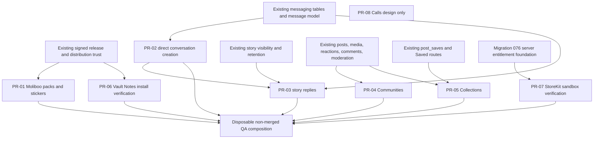

# GREENFIELD FEATURE REALITY 01 — pre-flight baseline

Mission: `GREENFIELD-FEATURE-REALITY-01`
Gate: `FEATURE-REALITY-GATE-00`
Recorded: 2026-10-31
Repository: `modula-mod/modula-latest`
Implementation worktree: `/root/modula-worktrees/greenfield-feature-reality-01`
First implementation branch: `feat/qa-moliboo-series2-packs`

## Gate conclusion

`FEATURE-REALITY-GATE-00` is complete for source and read-only runtime inspection. The mission is **not yet QA ready**.

The current GreenField implementation is Fastify/TypeScript/PostgreSQL. The required Moliboo, Communities, Collections, Drafts, Story Reply, Premium purchase-verification, and Calls-design outcomes are not all present. Existing package distribution, social posts, Saved items, stories, messaging, and Premium foundations must be extended rather than replaced.

No production file, database record, object, key, release, image, deployment, or branch was changed during this gate. `/root/modula-latest` remained untouched. The native repository was inspected read-only and is not an implementation target for this mission.

Write-capable QA work remains fail-closed until a mission-specific disposable database, media root, signing key, API, and worker are provisioned from the exact implementation ref. Existing QA services do not provide that complete combination.

## Verified lineage

| Subject | Verified identity | State |
| --- | --- | --- |
| GreenField `origin/main` | `bae20cebb48685c56ed5ccfe5537f121e3f36110` | Current mission base; merge of PR #146 |
| Mission branch HEAD | `bae20cebb48685c56ed5ccfe5537f121e3f36110` | Clean and source-identical to `origin/main` when this gate was recorded |
| Native `origin/main` | `20fcf3cc7acdce677d9de5091107ddfe884bd31b` | Read-only authority; merge of native PR #239 |
| Native reference checkout | `be679c8672a9cb0a857087e3e90ab7df644b1899` | 129 commits behind; not treated as current authority |
| Production checkout | `db0e1e31c19f07538198c8191fa97976c39a7684` | Clean, read/deploy-only, behind main by design |
| Production API image | `modula-greenfield-api:db0e1e31c19f07538198c8191fa97976c39a7684` | Healthy container; `/v1/health/ready` returned 200 |
| Production worker image | `modula-greenfield-worker:db0e1e31c19f07538198c8191fa97976c39a7684` | Current heartbeat carries the same release SHA |
| Production migration | `075_greenfield_messaging` | Deliberately behind source; production was not advanced |
| Current source migration | `079_story_attachment_pipeline` | Migrations 076–079 are merged on main |

The production worker heartbeat observed at the gate was `greenfield-worker-phase7i-d2` with release SHA `db0e1e31c19f07538198c8191fa97976c39a7684`. This is runtime identity evidence only, not authorization to deploy.

## API Atlas baseline

The supplied baseline is accurate for current main:

| Measure | Result |
| --- | --- |
| Application routes | 484 |
| Framework-derived routes | 205 |
| Runtime method routes | 689 |
| Source-only routes | 0 |
| Unmapped application routes | 0 |
| Atlas verification | 95/95 checks passed |
| Candidate semantics | `GITHUB_HEAD_REF=main API_ATLAS_RUNTIME_EVIDENCE=candidate` |

Verification command:

```text
CI=true GITHUB_HEAD_REF=main API_ATLAS_RUNTIME_EVIDENCE=candidate pnpm api:atlas:verify
```

Current generated artifacts are JSON, CSV, Markdown, OpenAPI YAML, Mermaid, and supporting evidence files under `docs/audits/api-atlas-01`. There is **no Atlas DOCX artifact or DOCX generator in the repository**. The CSV exists and passes the verifier. The DOCX requirement is therefore a mission implementation gap; a generated DOCX must be added without making it a second contract source.

## QA safety gate

### Existing runtime evidence

| Environment | API/worker ref | Database migration | Readiness | Write decision |
| --- | --- | --- | --- | --- |
| Production | `db0e1e31…` | 075 | Ready | Prohibited |
| Premium QA | `58bde349…` | 076 | Ready | Isolated, but stale and Premium-specific; not the mission integration environment |
| Functional-parity PostgreSQL | No attached current API/worker | 079 | Database only | Read-only baseline evidence; do not treat as an end-to-end runtime |
| Game Platform QA API | `qa-aae70687` | Historical fixture database | `API not ready: unknown migrations` | Blocked |
| On-demand package QA APIs | Historical `02r` refs | Historical fixture database | `API not ready: seed missing` | Blocked |

Premium QA and package QA use database URLs, media roots, and checkpoint signing keys that are separate from production. They run with `MODULA_ENVIRONMENT=preview`; Premium QA also has production writes disabled, registry disabled, and Apple auth disabled. The package QA registry is enabled against separate storage, but those APIs are not ready. No inspected QA environment can publish to the public registry through an active automated publisher.

Both the functional-parity and Premium QA databases report the Apple billing adapter as `NOT_CONFIGURED`. The other commercial adapters are also `NOT_CONFIGURED`; only the enterprise-admin test adapter is active. StoreKit sandbox verification cannot be accepted from these environments.

### Required mission QA boundary before any write

1. Create a new disposable PostgreSQL database whose name identifies this mission and whose host binding is loopback-only.
2. Create mission-specific runtime and migrator roles; do not reuse production credentials.
3. Apply the full migration chain from the exact branch under test.
4. Use a mission-specific media root and QA signing key identifier/keypair.
5. Start API and worker images labeled with the exact branch commit and expected migration.
6. Keep production writes, public publication, production object storage, and real billing disabled.
7. Prove `/v1/health/ready`, worker heartbeat release identity, migration tip, and configuration separation before integration fixtures are written.
8. Treat down migrations that delete data as non-recovery procedures. Recovery is backup/restore plus the prior retained API/worker images.

The host production backup service was in a failed systemd state during inspection. This is an operational production concern, not a reason to mutate production during this mission.

## Feature reality matrix

`EXISTING AND WORKING` is used only where the required behavior is implemented and currently evidenced. Source presence alone is not counted as runtime acceptance.

| Required feature | Classification | Evidence | Acceptance gap |
| --- | --- | --- | --- |
| Generic signed package distribution | PARTIAL | Existing release descriptors, Ed25519 trust, immutable SHA-256 artifacts, compatibility, permission review, revocation, install plans, and rollback selection are implemented with regression tests | No current-main QA API/worker lifecycle proof in this mission yet |
| Moliboo Series 2 pack delivery | PARTIAL | Native main has 100 draft source records for IDs 116–215 and a content-only PackageManager | No GreenField Moliboo registry, releases, routes, ownership, outfit persistence, or approved signed QA releases |
| Moliboo ownership/outfit | MISSING | No Moliboo tables or routes in GreenField | Server authority and concurrency invariants are absent |
| Sticker packs | PARTIAL | `GET /v1/stickers/packs` exists and native can consume its simple list | Static generic emoji fixture only; no pagination, typed schema, Sprout/Series artwork delivery, or distribution contract |
| Direct conversation creation | PARTIAL | `POST /v1/conversations` exists; direct-key uniqueness and basic integration tests exist | Handle-only body, unsafe concurrent loser path, non-idempotent optional initial message, incomplete privacy/error contract, and no native create call |
| Story replies into DMs | MISSING | Stories and messages exist independently | No reply route, idempotency, story context, notification, or realtime delivery |
| Communities | MISSING | Native main explicitly identifies a Release-off, device-only shell | No server schema, routes, permissions, persistence, fixtures, or Atlas contracts |
| Existing Saved items | EXISTING AND WORKING | Save/unsave and `GET /v1/saves` persist `post_saves`; native consumes the list | Existing list has no mission collection semantics and must not be replaced |
| Named Saved collections | MISSING | Native collections are device-local | No collection schema, ownership, synchronization, pagination, or routes |
| Post drafts | MISSING | Native `DraftStore` is private local-file persistence | No server draft schema, revision contract, publish transaction, or exactly-once behavior |
| Vault Notes install plan | PARTIAL | Canonical route and signed package infrastructure exist; canonical ID in source is `digital.modula.vault-notes`, current contract target 2.0.2 | Current functional-parity data contains synthetic/historical fixtures, not a proven canonical 2.0.2 QA install-to-open lifecycle |
| Premium entitlements | PARTIAL | Migration 076 and routes implement server-derived membership, expiry/revocation/downgrade, badge separation, and verification separation | Purchase is explicitly disabled; Apple adapter is not configured; no verified StoreKit transaction/notification lifecycle |
| Calls architecture | MISSING | No runtime implementation is required or authorized | Design document, state machine, proposed contracts, threat model, dependencies, and approval decisions are not yet present |

## Series 2 asset and package findings

Native `origin/main` contains exactly 100 Series 2 packages, numbered 116 through 215. The first record is Brinlo (`moliboo.character.116` / `moliboo.116`) and the last is Jubilo (`moliboo.character.215` / `moliboo.215`). Every record is currently `draft`, `purchasable: false`, and `signed: false`.

There is a material artwork-provenance conflict:

| Ref | Brinlo portrait SHA-256 | Jubilo portrait SHA-256 | Presentation |
| --- | --- | --- | --- |
| Native commit `791d42e…` (PR #238) | `59337a410a77bef43d1ef6618171d4f49fe982e83da5db17e6e858f3a601abab` | `0b5bc4c828f39d8f938479314600385c65ffe6a7b814efab3a7a3f852867991c` | Painted poster cutouts |
| Native `origin/main` `20fcf3c…` (PR #239) | `cd9235e3bbf8cdbbb70fd440a19b6ac554e6de56e2e80a5a6c6757f0062746df` | `a38a62d29ea3c547f1947a7b80136fd0be2f6505b022de8549f975805513f723` | Glossy figures plus unpacked SVGs |

The mission explicitly requires the painted poster-cutout presentation and forbids replacement artwork. Therefore PR-01 must source the preserved PR #238 bytes by immutable Git identity, not the glossy `origin/main` portraits. No asset may be advertised as approved until its provenance and approval state are recorded. Missing or unapproved originals remain per-pack blockers; they may not be fabricated.

The native Moliboo PackageManager already enforces a content-only format and atomic activation/rollback. Its current explicit limits are 6 MiB artifact bytes, 8 MiB decoded bytes, 16 files, 4 MiB per file, and the allowed installed extensions `.json` and `.png`. It verifies Ed25519 trust, artifact and file hashes, stable paths, compatibility, staging, activation, last-known-good retention, and rollback. GreenField must bind Moliboo descriptors into the existing server trust chain rather than introduce another signer or installer.

## Relevant existing route inventory

| Route | Current state |
| --- | --- |
| `GET /v1/stickers/packs` | Public, static unpaginated fixture |
| `GET /v1/conversations` | Authenticated |
| `POST /v1/conversations` | Authenticated; body currently accepts `handle` and optional `text` |
| `GET /v1/conversations/:id/messages` | Authenticated |
| `POST /v1/conversations/:id/messages` | Authenticated |
| `POST /v1/conversations/:id/read` | Authenticated |
| `GET /v1/conversations/unread` | Authenticated |
| `GET /v1/stories/rail` | Public registration with viewer-sensitive filtering |
| `GET /v1/stories/:groupId` | Public registration with viewer-sensitive filtering |
| `POST /v1/stories` | Authenticated |
| `POST /v1/stories/items/:itemId/viewed` | Authenticated |
| `DELETE /v1/stories/items/:itemId` | Authenticated |
| `GET /v1/saves` | Authenticated |
| `POST /v1/modules/:moduleId/package-install-plan` | Authenticated |
| `GET /v1/premium/tiers` | Authenticated |
| `GET /v1/me/membership` | Authenticated |
| `GET /v1/me/entitlements` | Authenticated |
| `GET /v1/me/entitlements/:capabilityId` | Authenticated |
| `PATCH /v1/me/membership/badge-visibility` | Authenticated |

No current Atlas route begins with `/v1/moliboos`, `/v1/communities`, `/v1/me/collections`, or `/v1/me/drafts`. No story-reply route is registered.

## Native compatibility findings

- Share delivery scans existing conversations and reports `No chat with … yet` when no thread exists. It does not call `POST /v1/conversations`.
- Story capability has `reply = false`; the reply UI explicitly says there is no reply endpoint and opens Messages without sending a DM.
- Communities are always disabled in Release and store settings, poll interest, and event interest on the device.
- Collections and drafts are device-local. Saved posts alone are server-backed.
- Premium uses local StoreKit configuration as a non-charging preview. Native main explicitly does not call `Product.purchase` or `SKPaymentQueue`, and does not submit a transaction to GreenField.
- Moliboo Series 2 packages are local draft source material; no production GreenField base URL is configured for their package catalogue.

These are native integration gaps, not authority to change the native repository in this server mission.

## Database and migration baseline

The source migration lineage is:

```text
075_greenfield_messaging
076_greenfield_premium_entitlements
077_optional_package_media
078_gubic_game_catalogue
079_story_attachment_pipeline
```

Existing migrations are immutable. New workstreams must append new numbered migrations. Multi-record changes require transactions, database uniqueness for retry/concurrency invariants, and indexes for each bounded list/access path.

Migration recovery for persistent QA is snapshot/restore plus a prior retained application image. Destructive `.down.sql` files are test-cycle aids only and are not the recovery plan for user data.

## Relevant tests and known failures

The repository currently contains 88 GreenField API test files and 14 worker test files. Relevant suites include messaging integration, story integration and attachment integration, social save behavior, registry signing/trust/revocation, package closure/version switching, Premium/Verification, Atlas verification, and migration validation.

Known evidence gaps or failures at the gate:

1. No mission-specific database-backed tests have run yet; none are reported as passing.
2. Package QA readiness fails with unknown migrations or missing seed data.
3. Functional-parity PostgreSQL is at migration 079 but lacks an attached exact-ref API/worker runtime.
4. Premium QA is ready but is pinned to ref `58bde349…` and migration 076.
5. Apple billing adapter state is `NOT_CONFIGURED` in both inspected QA databases.
6. The functional-parity Vault Notes rows are synthetic/historical fixtures and do not prove the canonical 2.0.2 package lifecycle.
7. Atlas has no DOCX artifact/generator.
8. Production backup systemd service is failed; no production repair is authorized by this mission.

Skipped or unexecuted tests are not PASS.

## Known PRs

Open GreenField PR at the gate:

- Draft PR #133, `phase/vault-record-metadata-01`, “Preserve generic module record metadata and legacy references”. It must not be overwritten or silently superseded.

Open native PRs at the gate:

- PR #113, `fix/shell-chrome-tests`.
- Draft PR #77, `phase/product-ui-polish-01`.

Relevant merged GreenField PRs include #134 messaging, #136 dependency resolution, #137 signed package closures/install-plan binding, #138 Premium/Verification foundations, #140 package revocation errors, #141 GUBIC, #142 story attachment repair, #143 media cleanup, #144 API/native reconciliation, #145 Vault Notes 2.0.2 acceptance alignment, and #146 generic Tasks record proof.

There is no active Premium implementation PR to reuse: PR #138 and its documentation PR #139 are already merged. PR-07 must branch from its accepted foundation without duplicating it.

## Last 20 GreenField main commits

1. `bae20ceb` Merge PR #146: Prove generic Tasks records end to end
2. `7b495b9f` Prove generic Tasks record lifecycle
3. `8d684fc3` Merge PR #145: Align Vault Notes backend acceptance with 2.0.2
4. `f0193a08` Align Vault Notes canonical release with 2.0.2
5. `96bfc715` Merge PR #144: Reconcile GreenField API usage with Native and production
6. `7ba3f8a6` Allow source-identical Atlas evidence across feature branches
7. `0472652a` Reconcile GreenField routes with Native and production
8. `e32409ad` Merge PR #143: Schedule safe shared-media lifecycle cleanup
9. `ccaa3826` Refresh Atlas for media lifecycle worker
10. `22ca9947` Schedule safe attachment lifecycle cleanup
11. `908f6a30` Merge PR #142: Repair attachment-backed story and AR media publishing
12. `fce0a0e7` Isolate database auth limiter test state
13. `e8c46616` Refresh Atlas for story media contract
14. `5b8dde5e` Repair attachment-backed story publishing
15. `b923f52d` Merge PR #141: Establish GUBIC backend and retire Expo mobile apps
16. `00fac12d` Remove retired patch inputs from service images
17. `a18e191e` Establish GUBIC backend and retire Expo mobile apps
18. `a100f86f` Merge PR #140: Return explicit revocation errors for package plans
19. `5dadabbb` Refresh Atlas capture after revocation precedence fix
20. `d916127e` Classify revoked packages before generic trust failure

## Last 20 native main commits

1. `20fcf3c` Merge PR #239: Series 2 glossy figures
2. `1d588f5` Redraw Series 2 as glossy figures in the in-app Moliboo style
3. `26f0b9c` Merge PR #238: Series 2 poster cutouts
4. `791d42e` Replace Series 2 pack portraits with painted poster cutouts
5. `0375d3e` Merge PR #237: Community shell
6. `198cecd` Add a Release-off community shell with no invented members
7. `2040338` Merge PR #236: Product Hub variants
8. `294330b` Let Product Hub switch among story, list, space, and store layouts
9. `0f81e76` Merge PR #235: Appearance live preview
10. `199c4c6` Show Appearance changes in a live preview
11. `0ded09e` Merge PR #234: Photo filter dial
12. `208a876` Add a local Core Image dial for story photo filters
13. `9246c76` Merge PR #233: Premium purchase flow
14. `e14b6e1` Premium: sandbox purchase flow
15. `a4f7a58` Merge PR #232: Composer glass pill
16. `2ded9d1` Merge main into the composer pill branch
17. `caf5825` Collapse the comment and chat composers into a floating glass pill
18. `6a5495d` Merge PR #231: Saved collections and drafts
19. `9395700` Merge PR #230: Premium dashboard and manage screens
20. `d1c5824` Show saved posts from the account, and keep collections and drafts on device

## Implementation dependency graph



PR-03 must consume PR-02’s concurrency-safe find-or-create primitive. PR-04 must reuse the normal post identity and media pipelines. PR-05 must extend `post_saves` and the normal post-creation pipeline. PR-01 and PR-06 share the existing release trust chain but retain their distinct declared package content contracts. PR-08 has no runtime dependency and must not add deployed routes.

## Workstream order and initial gate status

| Mission item | Initial status | Next safe action |
| --- | --- | --- |
| PR-01 Moliboo packs/stickers | PARTIAL | Implement on current branch using poster-cutout immutable source refs; provision disposable QA before registry writes |
| PR-02 conversation creation | PARTIAL | Branch from current main after PR-01 is independently reviewable |
| PR-03 story DM replies | BLOCKED on PR-02 primitive | Design against existing story/message models; implement only on its own branch |
| PR-04 Communities | MISSING | Derive typed fields from native main and reuse posts/media/moderation |
| PR-05 Collections/drafts | MISSING | Extend Saved and post creation; add versioned synchronization |
| PR-06 Vault Notes | PARTIAL | Rebuild canonical QA registry fixture and run signed lifecycle |
| PR-07 Premium QA | BLOCKED for full acceptance | Apple product identifiers, billing periods, sandbox verification credentials, and server-notification configuration are not available and must not be invented |
| PR-08 Calls design | MISSING | Documentation only; keep proposed endpoints out of deployed Atlas routes |

## Gate commands

The gate used only read operations against production and native, plus generated candidate Atlas verification in the isolated mission worktree. Key reproducible commands are:

```text
git fetch origin --prune
git rev-parse HEAD
git rev-parse origin/main
CI=true GITHUB_HEAD_REF=main API_ATLAS_RUNTIME_EVIDENCE=candidate pnpm api:atlas:verify
git log --oneline --decorate -20 origin/main
gh pr list --repo modula-mod/modula-latest --state open
gh pr list --repo modula-mod/modula-native --state open
curl http://127.0.0.1:4020/v1/health/ready
```

Before implementation tests, commands must target the new mission-specific QA database explicitly through `MODULA_TEST_DATABASE_URL`. A package-wide run that skips database tests because that variable is missing is not acceptance evidence.

## Approval boundaries

No approval is required for source implementation, disposable QA testing, Atlas generation, or draft PR creation within this mission. Andy’s explicit approval remains required for every merge, production deployment, public package publication, real billing activation, and any live calling implementation.
