# Greenfield Backend V1 architecture

Greenfield is Modula's control plane and authoritative data ledger. Products own
product behaviour, engines own reusable capabilities, services own isolated
execution, and the credential broker owns credential use. Greenfield records
truth, policy, provenance and orchestration; it is not a container for every
product implementation.

This document is the architecture constitution for Greenfield Backend V1. A
subsystem is not production-complete merely because its contract appears here.
The canonical behavioral gate is `CI=true pnpm verify:greenfield-backend-v1`;
until that gate exists and passes, the checkpoint verifiers named below are the
source of truth.

## Ownership boundaries

| Greenfield owns | Product or service owns |
| --- | --- |
| accounts, identities, sessions and ownership | product-specific domain rules |
| publishers, products, releases and provenance | product UI and workflows |
| installations, lifecycle and dependencies | module-owned service implementation |
| capability grants, assertions and policy | dedicated database contents |
| the data-resource ledger and schema history | provider adapters behind an engine |
| events, jobs, audit, usage and entitlements | game rendering and simulation |
| service identities and secret handles | externally hosted systems |

Hard invariants:

- Raw Greenfield user bearer forwarding to a product service is forbidden.
- Modules never receive Greenfield database credentials or another product's
  database role.
- Service targets come from the validated service registry, not request URLs.
- Product code receives secret handles or brokered capability results, not
  provider keys.
- Installable artifacts are immutable and provenance-bound.
- Module UI is declarative; arbitrary remote JavaScript is not loaded.
- Test-only products cannot enter public catalogue visibility.
- Migrations require a fresh ACL-preserving backup and isolated restore,
  up/down/reapply rehearsal before production.

## Platform topology

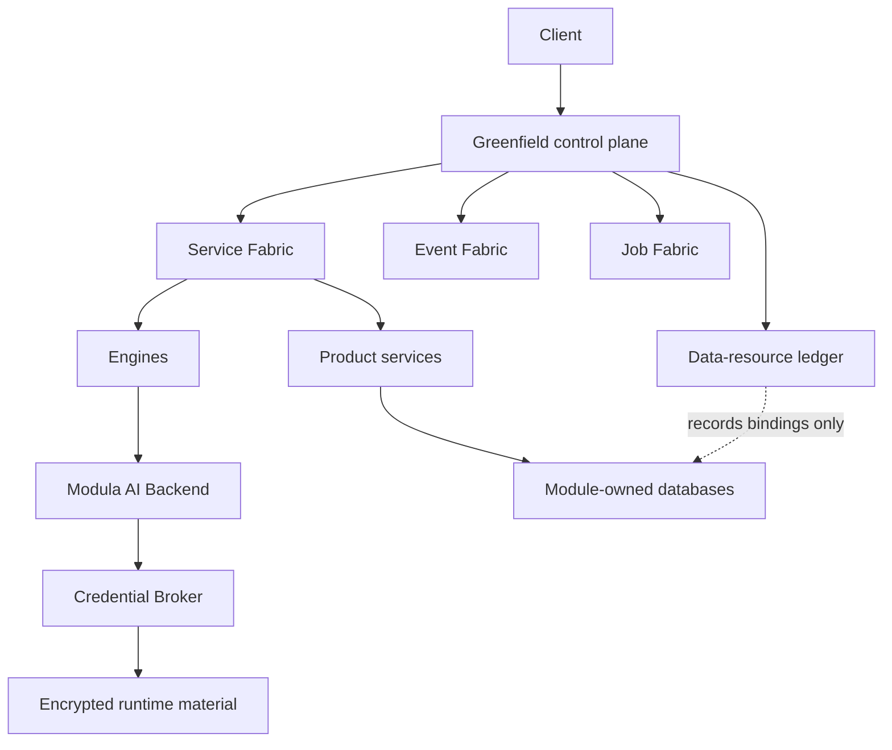

## Greenfield and module-only products

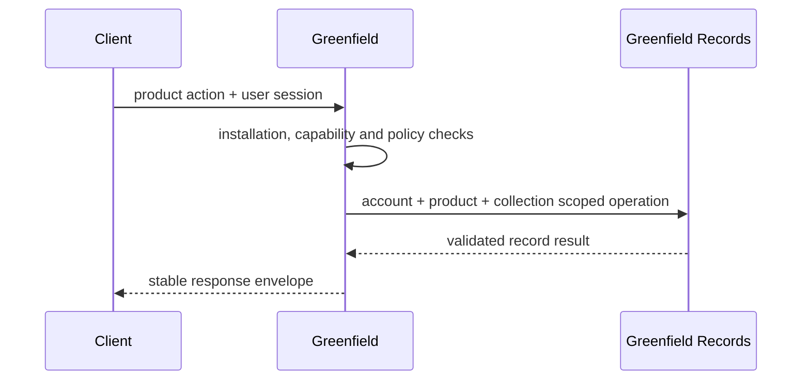

## Module-owned backend

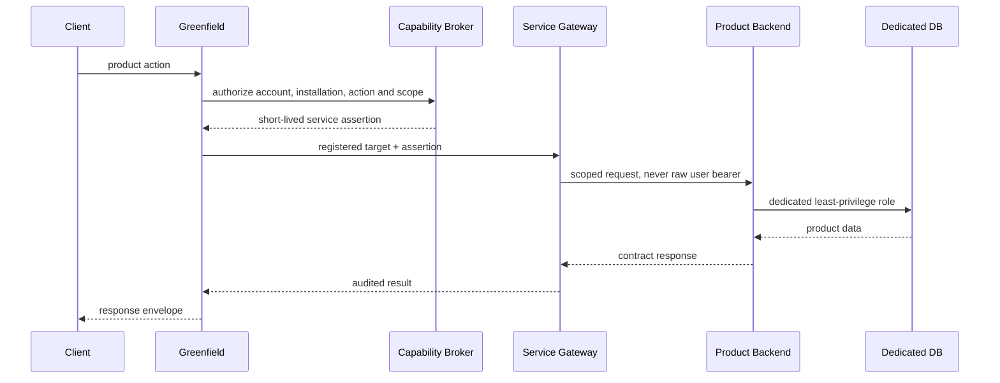

## Engine use

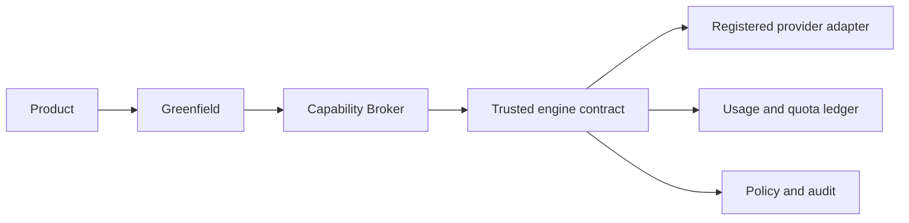

Trusted engines register capabilities, services, jobs, event consumers, health
and usage metrics through one stable loader interface. Ordinary third-party
products remain out of process behind Service Fabric.

## Host extensions and extension backends

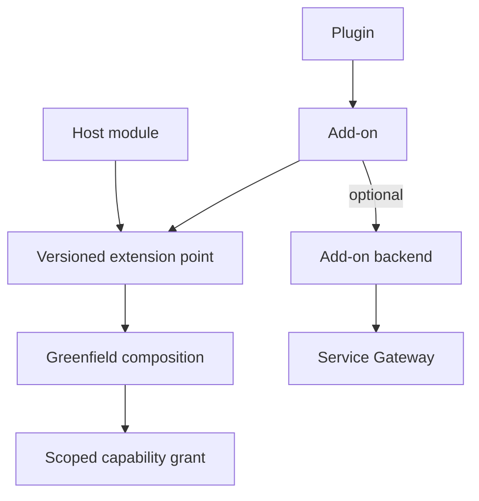

The dependency graph is acyclic and bounded by depth, fan-out and total nodes.
Contributions fail independently; an extension failure cannot disable its host.

## Data Ledger

Migration `041_greenfield_backend_v1_data_ledger` provides the canonical map:

| Contract | PostgreSQL table |
| --- | --- |
| resources and provenance | `greenfield_data_resources` |
| account ownership | `greenfield_data_resource_owners` |
| physical or service bindings | `greenfield_data_storage_bindings` |
| schema declarations | `greenfield_data_schema_versions` |
| migration audit | `greenfield_data_migration_history` |
| retention | `greenfield_data_retention_policies` |
| backup and recovery responsibility | `greenfield_data_backup_policies` |

Supported storage modes are `greenfield-records`, `dedicated-postgres`,
`object-storage` and `external-service`. A resource may have multiple bindings.
Bindings store opaque locators and optional `secret://` references, never
database passwords, provider keys, arbitrary filesystem paths or request URLs.

The database trigger `greenfield_validate_data_resource_scope` rejects any row
whose account, product, installation and release do not describe one installed
release. Application reads additionally enforce owner-account and product
scope. Standard 2 storage declarations are projected into the ledger at
installation; dynamic resources are registered through `GreenfieldDataLedgerService`.

Uninstall states are explicit:

- `RETAINED` keeps data for reinstall or later export.
- `EXPORT_PENDING` does not claim an export has happened.
- `DELETED` is used only when Greenfield completed deletion for bindings it
  controls.
- `DELETE_PENDING` records that an object store, dedicated database or external
  service still owes a verified deletion result.
- Legal hold prevents a resource from being marked deleted.

Schema migration records contain checksums, versions, attempt, reversibility,
state, timestamps and an audit reference. Product payloads and secrets are not
stored in migration history.

Checkpoint verifier:

```text
CI=true MODULA_TEST_DATABASE_URL=<disposable-db> pnpm verify:greenfield-backend-v1:data-ledger
```

## Service Fabric

Service Fabric owns validated targets, service identity, assertions, gateway
policy, bounded retry, timeout, circuit state and audit.

The public client never selects a service identity or sends an arbitrary target
URL. Greenfield derives the service identity from the reviewed release binding,
resolves the registered origin, validates every DNS result against the SSRF
policy, permits only declared origins or reviewed self-hosted hostnames, enforces
the declared port list, requires HTTPS, and follows zero redirects.

Every normal or extension-backed gateway action receives a short-lived service
assertion. The signed claims bind issuer, Greenfield gateway subject, consumer
product, target service, target product and installation, account scope,
capabilities, action, audience, `jti`, request ID and trace ID. The database
stores only its SHA-256 token hash and has a check constraint fixing
`raw_user_bearer_forwarded` to false.

Product services call Greenfield through the stable backend SDK routes under
`/v1/backend/products/:productId`. These routes accept only
`x-modula-service-assertion`; presenting an `Authorization` bearer is rejected.
The implemented V1 boundary covers identity context, safe account state,
installation state, effective capability grants, Greenfield Records and the
data-resource ledger. Event and job transports consume the same verified
identity in the Event/Job checkpoint rather than defining a second auth model.

Record and resource mutations require an idempotency key. Greenfield reserves
that key before mutation, detects mismatched replays and returns the recorded
result for an identical replay. The key is scoped by product and operation.

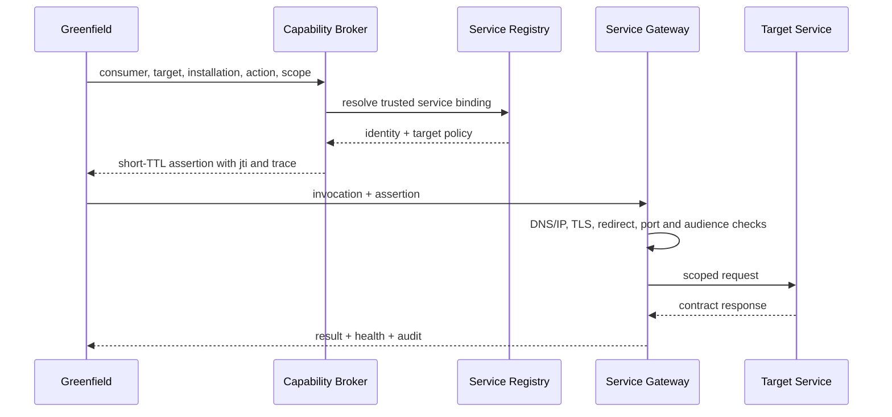

Checkpoint verifier:

```text
CI=true MODULA_TEST_DATABASE_URL=<disposable-db> pnpm verify:greenfield-backend-v1:service-fabric
```

## Engine contracts

- AI: provider-neutral completion, structured output, embeddings, health,
  fallback, policy, quota, usage and audit.
- Search: lexical, full-text and semantic search with public, account-private,
  module-private and shared scopes.
- Media and files: asset identity, ownership, checksum, metadata, thumbnails,
  transcode jobs, object bindings and signed access.
- Notifications: in-app, push, security email and module notification types with
  per-channel preferences.
- Realtime: presence, rooms, subscriptions, collaboration events and multiplayer
  signalling.
- Automation: trigger, condition, action, schedule and governed function calls.
- Entitlements: offers, grants, external purchase authority and Modula-local
  entitlement truth.
- Game services: player profile, sessions, saves, lobbies, matchmaking,
  leaderboards, achievements, inventory and game events.
- Avatar: state, render requests, asset references, jobs and permissions only.

## AI request and secret resolution

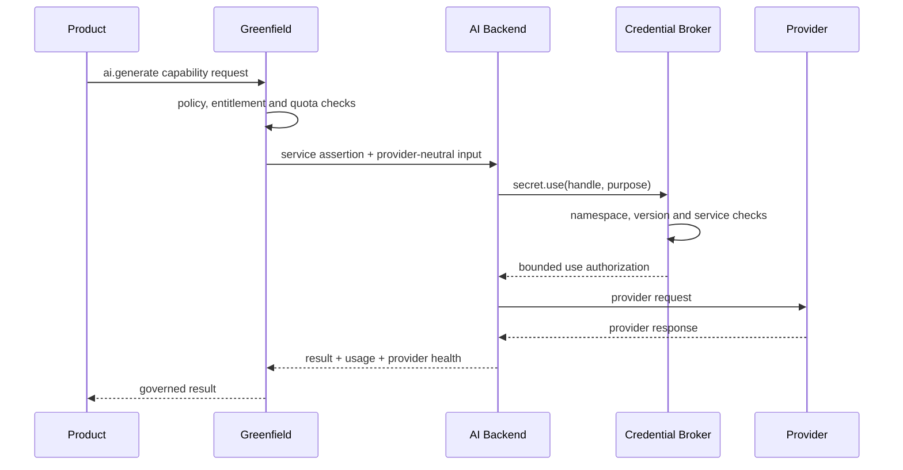

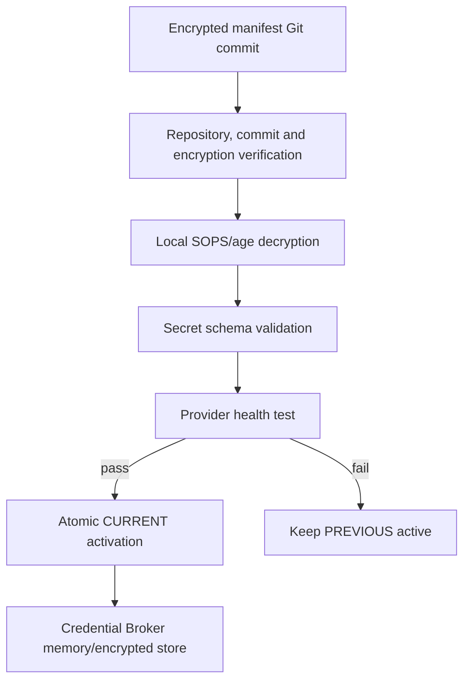

Git is provenance and configuration storage, never a synchronous runtime secret
database. Decryption keys remain outside repositories and images.

The canonical private repositories are:

- `modula-mod/modula-secrets-service`: assertion-authenticated broker and
  `modula-secrets-sync` reconciliation code;
- `modula-mod/modula-secret-manifests`: signed, age-encrypted manifests only.

Product backends request `POST /v1/backend/products/:productId/secrets/lease`
with their short-lived Greenfield service assertion and a `secret://` handle.
Greenfield forwards only that service assertion to the configured private
broker origin. The broker validates the signature, exact service ACL, namespace,
purpose and `secrets.use` capability, then returns a single-use short lease.
The lease response contains no secret value; direct value use is reserved for
explicitly trusted services with `secrets.use.direct`.

Runtime snapshots use AES-256-GCM and remain available without GitHub. Sync
requires a clean exact commit, the expected GitHub repository, a valid external
SSH commit signature, valid age ciphertext, schema validation and health. The
age identity and runtime keys remain root-owned mode `0600` outside Git.

## Event delivery

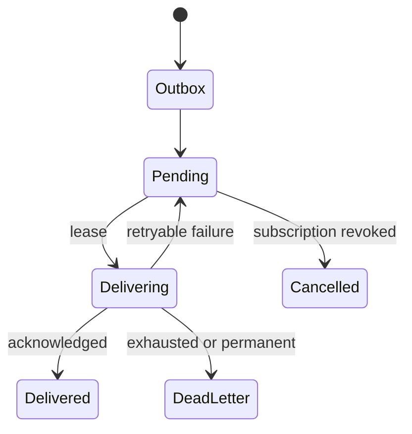

Every event has ID, versioned type, schema version, producer, account,
installation, timestamp, trace, classification and payload. Delivery validates
subscription permissions and is idempotent. Event payload schema changes create
new versions rather than silently mutating existing types.

## Job lifecycle

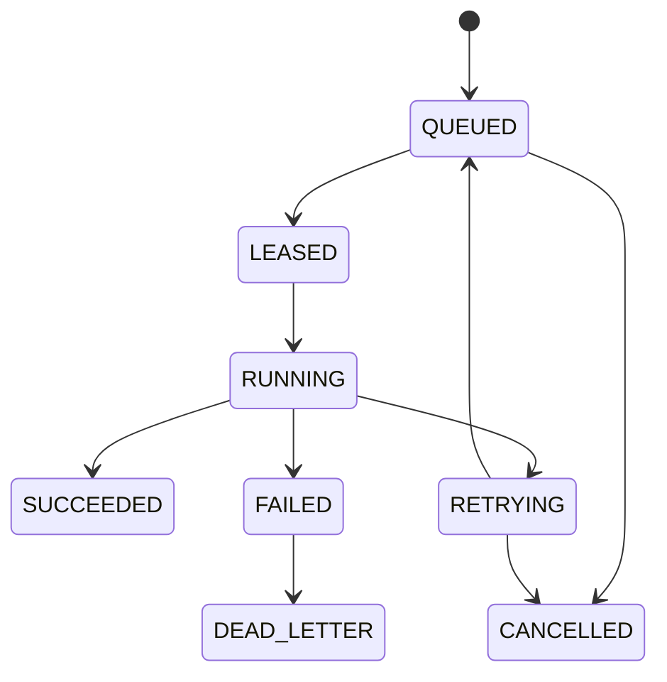

Jobs record owner, product, installation, action, service, attempt, timeout,
idempotency key, trace, lifecycle timestamps, result reference and error class.
Ordinary logs exclude input payloads and secret material.

## Builds, releases and private distribution

```mermaid
flowchart LR
  Source[Source repository] --> SHA[Exact SHA]
  SHA --> Runner[Isolated runner]
  Runner --> Install[Locked dependency install]
  Install --> Tests[Lint, typecheck, tests]
  Tests --> Validate[Manifest and security validation]
  Validate --> Artifact[Immutable artifact]
  Artifact --> SBOM[SBOM and licence inventory]
  SBOM --> Provenance[Checksums, builder identity and signature]
  Provenance --> Candidate[Candidate release]
  Candidate --> Review[Automated and manual review]
  Review --> Channel[Private, alpha, beta, RC or stable channel]
```

Build runners receive no production credentials, Docker socket, other product
source, Greenfield root session or host root filesystem.

## Entitlements and paid products

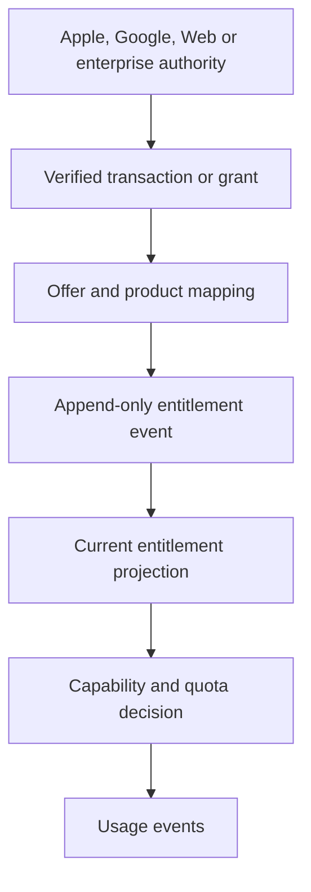

Greenfield is the entitlement authority inside Modula, while an external store
remains purchase authority for its transactions. No real charging is claimed
until merchant accounts, credentials, webhooks, refunds and store agreements are
configured and tested.

## Account export and deletion

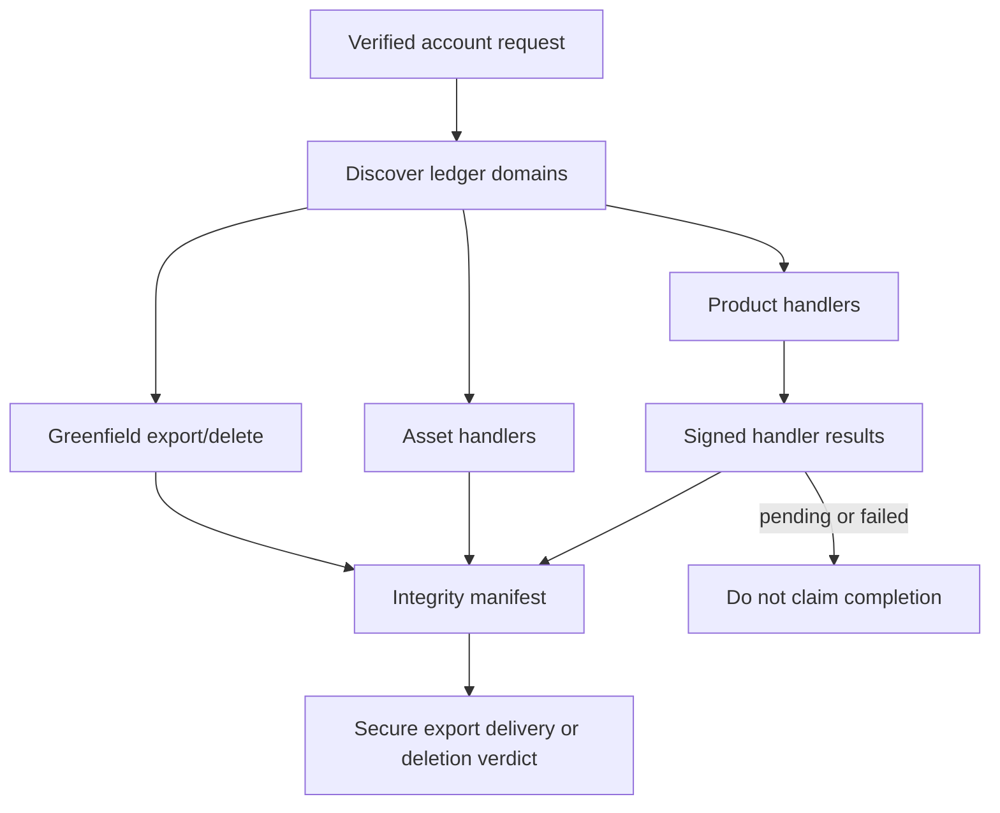

Module uninstall `deleteData` is scoped to one installation and cannot delete
unrelated product or account data. Account deletion discovers all data domains
and observes declared retention or legal holds.

## Backup and restore

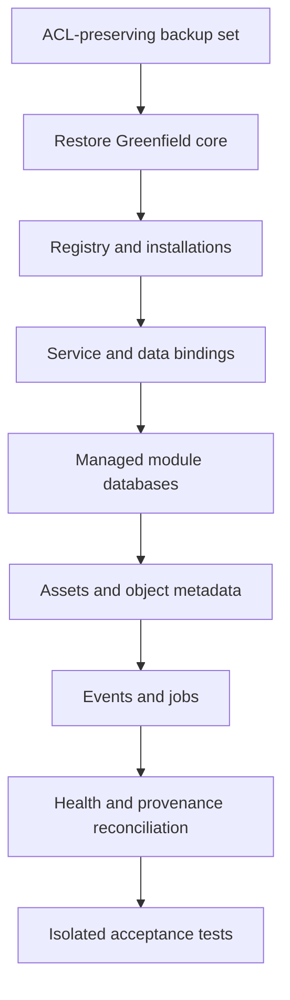

Backup coverage includes the Greenfield database, managed module DB registry,
module DBs under platform responsibility, object metadata, registry,
developers, entitlements, events, jobs, secret metadata and build/release
metadata. Secret values and external decryption keys follow their own recovery
procedure. A backup is not accepted until an isolated restore succeeds.

## Security and observability

Request and trace context propagates account, organisation, product, release,
installation, service, job and event identifiers where applicable. Logs redact
authorization, cookies, tokens, credentials, secret handles where sensitive,
database URLs and user content. Each service reports live, ready, dependencies,
version and revision; Greenfield aggregates topology without secrets.

Rate limits are separated by auth, public, user, module, service, developer,
build, AI, search, upload, event and job classes. Abuse controls additionally
bound accounts, services, publishers, jobs and builds.

Security acceptance must execute cross-account and cross-product isolation,
SQL privilege, capability escalation, service impersonation, raw-bearer, SSRF,
redirect, dependency, artifact, manifest, secret, event, job, path, archive,
injection, remote-code, sandbox, entitlement and namespace impersonation tests.

## Recovery and release discipline

Every Greenfield-hosted production release must converge source main, web, API,
worker and container revision labels to one exact SHA. Independent services
report their own repository, release, commit and build ID. No production
component may depend on a `cursor/*` branch after a checkpoint converges.
